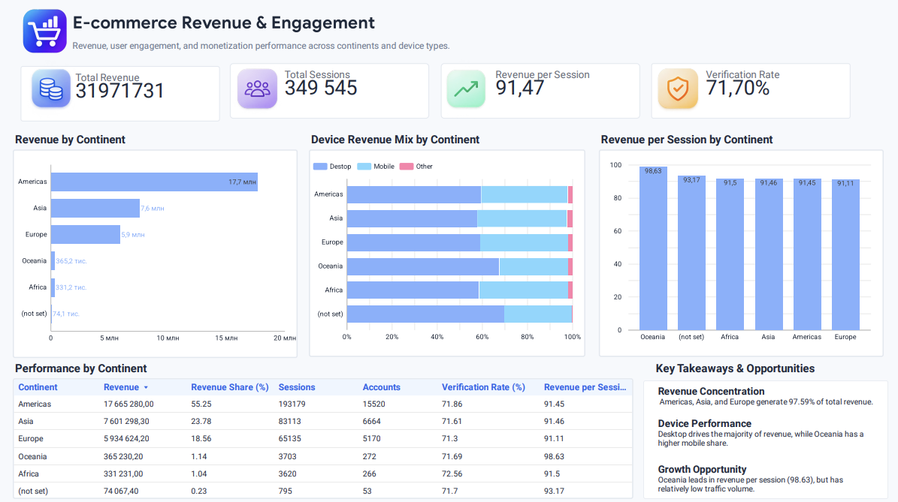

# E-commerce Revenue & Engagement Analysis

An SQL-based analysis of e-commerce revenue, user engagement, and monetization performance across continents and device types.

**Tools:** Google BigQuery · SQL · Looker Studio

[View Interactive Dashboard](https://datastudio.google.com/reporting/4f80f1f0-eb1e-4480-be8b-03caffd5c5ca)

## Dashboard Preview



## Project Overview

This project analyzes e-commerce revenue and user activity across geographic markets and device types.

The goal is to identify key revenue contributors, compare monetization efficiency, and highlight potential opportunities for further investigation.

## Business Questions

1. Which continents generate the most revenue?
2. How does revenue distribution vary by device type?
3. Which continents generate the highest revenue per session?
4. How do session volume and account verification vary across continents?

## Data & Methodology

The analysis uses four datasets in Google BigQuery:

- `DA.order` — order records
- `DA.product` — product prices
- `DA.session_params` — session and device information
- `DA.account` and `DA.account_session` — account and verification information

The SQL query uses CTEs, JOINs, conditional aggregation, window functions, and safe division to calculate revenue and engagement metrics.

The results are aggregated by continent and visualized in Looker Studio.

## Key Metrics

| Metric | Description |
|---|---|
| Total Revenue | Sum of product prices associated with orders |
| Total Sessions | Number of distinct sessions |
| Revenue per Session | Total revenue divided by total sessions |
| Verification Rate | Share of verified accounts within continent-level account counts |
| Revenue Share | Percentage of total revenue generated by each continent |
| Device Revenue Mix | Distribution of revenue across desktop, mobile, and other devices |

## Key Findings

### Revenue Concentration

Americas generates 55.25% of total revenue. Together, Americas, Asia, and Europe account for 97.59% of revenue.

### Device Performance

Desktop generates the majority of revenue. Oceania has a relatively higher mobile revenue share than the major markets.

### Monetization Efficiency

Oceania has the highest revenue per session among identified continents (98.63), although its traffic volume is relatively low.

## Project Structure

```text
ecommerce-revenue-analysis/
├── README.md
├── sql/
│   └── revenue_analysis.sql
└── images/
    └── dashboard_preview.png
```

## Notes

This project was completed as part of SQL and analytics training.

The analysis is based on aggregated educational data. Findings are descriptive and do not establish causal relationships.

